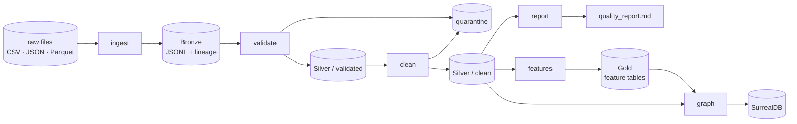

# Architecture

This pipeline turns eight messy source files into validated tables, business features and a
SurrealDB knowledge graph. This document records **why** it is built the way it is, the
trade-offs I accepted, and what I would change before running it in production.

Detailed references: [cleaning rules](docs/CLEANING_RULES.md) · [feature dictionary](docs/FEATURES.md) ·
[graph model](docs/GRAPH_MODEL.md) · [logging examples](docs/LOGGING.md) · [raw data profile](outputs/profiling/raw_data_profile.md).

---

## 1. Overview



| Stage | Input → output | What it owns |
|---|---|---|
| `ingest` | raw files → `bronze/*.jsonl` + `_manifest.json` | reading every format, exploding invoice line items, lineage columns, completeness check against source envelopes |
| `validate` | Bronze → `silver/validated/*.parquet`, `quarantine/*.csv` | parsing and typing one record at a time (Pydantic schemas), record-level rules |
| `clean` | validated → `silver/clean/*.parquet` | dataset-level rules: duplicates, referential integrity, cross-record evidence |
| `report` | Silver → `outputs/quality_report.md` | cleaned vs rejected statistics, generated from rule results |
| `features` | Silver clean → `gold/*_features.parquet` | the 21 brief features plus RFM, one revenue definition |
| `graph` | Silver + Gold → SurrealDB, `outputs/graph_queries.md` | schema, idempotent load, the 8 queries |

One run on the assessment data takes about five seconds end to end:
11,011 records in (including 3,618 exploded invoice lines), 44 quarantined, 41 duplicates removed, 2,390 nodes and 11,833 edges loaded.

```bash
docker compose up -d surrealdb      # graph target
python run_pipeline.py              # all stages
python run_pipeline.py --stages features graph   # any subset; upstream outputs are read from disk
```

---

## 2. Design decisions

Each decision lists what I chose, why, what it costs, and what I would do at production scale.

### 2.1 Profile first, then write rules

**Choice.** Before writing a single cleaning rule I profiled the raw files
(`scripts/data_profile.py`, read-only). Every rule in the registry is backed by a measured count.

**Why.** The README lists known issues, but a list is a hypothesis. Profiling found issues the
README does not mention, and some it does mention that are not in this extract:
- **Ambiguous dates are not random.** Dash dates are always month-first, slash dates always day-first, and the 213 epoch values are midnight UTC+1. That made a deterministic parser possible instead of a "best guess" one.
- **Currency labels are wrong, not the amounts.** Every transaction and invoice amount equals the USD catalog value, whatever the label says. Converting "EUR" amounts would have corrupted correct numbers.
- **Invoice `due_date` always equals `invoice_date`**, ignoring the NET terms.
- **Source aggregates are unreliable.** Customer `total_spend` has a correlation of −0.008 with actual transactions.

**Trade-off.** It costs time before any pipeline code exists. It saved more than it cost: the
currency finding alone would have been a silent revenue error.

**In production.** Profiling becomes a scheduled job with drift checks (null rates, format mix,
value distributions per batch) so a new source format is caught before it reaches Silver.

### 2.2 Medallion layers with files as the contract between stages

**Choice.** Bronze keeps every record as it arrived (values untouched) plus lineage; Silver is
typed and cleaned; Gold holds business features. Stages read and write files, not in-memory objects.

**Why.**
- **Replay.** If a cleaning rule changes, I rerun from Bronze without touching the sources.
- **Debuggability.** Every stage's output can be opened and checked on its own.
- **Independence.** Any stage can be rerun alone (`--stages graph`); a failure in one does not force recomputing the others.

**Trade-off.** More I/O and storage than a single in-memory pass. At 11k rows that is irrelevant;
at scale it is the same trade every lakehouse makes, and it buys auditability.

**In production.** Delta or Iceberg tables in a catalog (Unity Catalog), with time travel instead
of overwritten files.

### 2.3 Lineage on every record

**Choice.** Ingestion adds `_batch_id`, `_ingested_at`, `_source_file`, `_source_file_sha256`,
`_source_row`, `_record_key` (business key from config) and `_record_hash`. These columns follow
the record through Silver and into quarantine.

**Why.** Any Silver row or rejected record can be traced to the exact file version and row it
came from. `_record_key` and `_record_hash` are what incremental loading needs: skip files whose
hash is already loaded, and `MERGE … WHEN MATCHED AND hash differs THEN UPDATE`.

**Trade-off.** Seven extra columns per row. Bronze is still overwritten each run here, so the
incremental path is prepared but not switched on.

**In production.** Append-only Bronze partitioned by `_batch_id`, and Silver updated with `MERGE`
on `_record_key`.

### 2.4 One rule registry, four actions, and quarantine as a last resort

**Choice.** Every check is a named rule (`transactions.unknown_customer`) with exactly one action:
- **fix**: a value was standardised or derived from evidence;
- **flag**: the record is kept, and the issue recorded in `dq_flags`;
- **quarantine**: the whole record is rejected, with the rule and the raw record;
- **drop**: a repeated primary key is removed, logged next to the kept copy.

The quality report and its statistics are generated from rule results, never written by hand.

**Why quarantine so little (44 of 11,011).** I quarantine only when the record as a whole cannot
be trusted: no usable identifier, or an impossible event (zero-quantity sale lines). A single bad
attribute is nulled and flagged instead. The clearest case is orphan transactions
(`CUS-INVALID-*`, `PRD-DELETED-*`, about 4%): they are real money. Quarantining them would
understate revenue; keeping them flagged keeps revenue honest, and the graph simply creates no
edge to a customer that does not exist.

**Trade-off.** Downstream consumers must respect flags. A data scientist who ignores `dq_flags`
gets the flagged rows too. Quarantine-heavy pipelines are simpler to consume but lose data quietly.

**In production.** Agree each rule's action with the data owner, and alert when a rule's hit rate
moves outside its normal range (a jump in `unknown_customer` usually means an upstream bug, not
bad customers).

### 2.5 Evidence over assumption for corrections

**Choice.** A value is only changed when the data itself proves the correction:
- currency labels are relabelled to USD (original kept in `src_currency`), not FX-converted, because the amounts match USD prices;
- a missing product category is inferred from the product name only where the name maps to one category;
- a source aggregate (`total_spend`) is never trusted; it is recomputed from transactions and the source value kept as `src_*`.

**Why.** A plausible-looking fix that is wrong is worse than a flag. Each fix is recorded in
`dq_fixes` so it can be audited and reversed.

**Trade-off.** Fewer automatic corrections. Some records stay flagged that a more aggressive
pipeline would have "repaired".

**In production.** These findings go back to the source owners as data contract issues. The
currency relabel holds for this extract only; a new batch must re-prove it before it applies.

### 2.6 Deterministic and idempotent by construction

**Choice.**
- `as_of_date` comes from config (2025-01-01), never `now()`, so recency, tenure and overdue days do not drift between runs.
- Duplicates resolve deterministically (latest `updated_at`, then first seen).
- Graph record ids are business keys (`product:⟨PRD-000001⟩`) and every write is an upsert; records not written by the current batch are pruned after the whole load has succeeded.
- Every query has a full `ORDER BY` with tie-breakers.

**Why.** Rerunning after a failure must be safe and must give the same answer. The integration
tests check this: a second run produces identical outputs apart from the batch columns, and a
second graph load changes nothing.

**Trade-off.** A fixed `as_of_date` must be moved deliberately for a new run period.

**In production.** `as_of_date` becomes the scheduled run's logical date (as in Airflow or
Databricks Jobs), so backfills reproduce historical results.

### 2.7 One revenue definition, used everywhere

**Choice.** Revenue is recognised when `payment_status = paid` and the order is not cancelled,
net of discount, with returns negative. It is defined once (`recognised_sales`) and used by the
features and by the graph's `recognised` edge flag.

**Why.** Two definitions of revenue in one system is how dashboards end up disagreeing with finance.
Failed and refunded transactions stay in Silver and the graph as behaviour; they just do not count.

**Trade-off.** The definition is mine. Finance may want, for example, revenue at order time
rather than at payment; it is one function to change.

### 2.8 pandas and Pydantic

**Choice.** pandas for tables, Pydantic v2 models for per-record validation, a YAML config
validated by Pydantic.

**Why.** At this size the priority is clear, testable rules. Pydantic gives each rule a readable
home and a typed result; validating 11k records takes under half a second.

**Trade-off.** Per-record Python validation does not scale to hundreds of millions of rows.

**In production.** Vectorised checks (Polars, or Spark with expectations), keeping the same rule ids
so the registry and the reports carry over unchanged.

### 2.9 Graph model

The full rationale is in [docs/GRAPH_MODEL.md](docs/GRAPH_MODEL.md). The decisions that matter most:
- **One `purchased` edge per transaction**, not per customer–product pair, so date, quantity and status remain queryable;
- **Gold features as node properties**, so queries filter on `days_overdue` instead of recomputing it;
- **country and region as nodes**, so "customers in Europe" is a traversal, not string matching;
- **a precomputed `similar_to` co-purchase edge**, so "bought together" is one hop;
- **tickets, reviews and calls as text nodes** linked to their customer and product, ready for GraphRAG retrieval;
- **no email, phone or street address in the graph** (data minimisation).

**Two engines.** The default target is the SurrealDB 4.0 server in Docker. The Python client's
embedded engine (SurrealDB 2.0) remains available for running without Docker. The two differ:
- the client sends datetimes in a format the 4.0 server rejects, so the loader encodes them itself;
- function names changed between versions, so the queries stick to functions common to both.

The integration tests load and query both engines and check the results against pandas.

**Trade-off.** Edges to records that do not exist are skipped, and counted in the log and the
report. Graph-traversal revenue is therefore lower than Gold revenue by exactly the sales to
unknown customers. That gap is explained, not hidden.

### 2.10 Failure isolation and error messages

**Choice.** Stages declare dependencies. A failing stage is logged with its traceback; stages
that depend on it are skipped; independent stages still run; the process exits non-zero.
Errors name the fix, for example:
"SurrealDB is not reachable at ws://localhost:8000/rpc. Start it with `docker compose up -d surrealdb`…"

**Why.** A broken graph load should not prevent the quality report from being produced, and an
on-call engineer should not have to read code to know what to do.

**Trade-off.** A partial run is possible, so the exit code and summary line must be checked.
The integrity checks themselves are strict: the graph load fails if any table's count differs
from what was built.

### 2.11 Configuration and secrets

**Choice.** One YAML file (`config/pipeline_config.yaml`) for paths, sources, primary keys,
`as_of_date`, feature windows and the SurrealDB target, validated by Pydantic at start-up.
Environment variables override the file location (`PIPELINE_CONFIG`) and the database URL
(`SURREAL_URL`). Credentials are read only from the environment (`SURREAL_USER`, `SURREAL_PASS`).

**Why.** A typo in config fails at start-up with a clear message, not halfway through a run. The
same code runs locally, in tests and in CI with different settings.

**In production.** Secrets come from a secret manager, and the database uses a scoped, non-root
user over TLS.

### 2.12 Observability

**Choice.** loguru with two outputs per run:
- a readable console line;
- a JSON-lines file (`outputs/logs/pipeline_<run_id>.jsonl`) where every record carries `run_id`, `stage` and structured fields (`rows`, `quarantined`, `duration_s`).

Examples are in [docs/LOGGING.md](docs/LOGGING.md).

**Why.** The JSON file is machine-readable, so row counts and rule hits per run can be loaded
into a table and trended without parsing text.

**In production.** Ship the JSON logs to the platform's log store; turn the per-stage counts into
metrics with alerts (quarantine rate, skipped edges, stage duration).

### 2.13 Testing strategy

| Layer | What is tested | Example |
|---|---|---|
| Unit | parsers, every rule family, feature formulas, graph mapping, config | `dd/mm` vs `mm-dd` dates, NaN-to-None conversion, RFM scoring |
| Integration | the real pipeline on the real data | every record accounted for (valid + quarantined = read; clean = valid − duplicates); feature revenue reconciles with transactions; reruns are identical |
| Graph | load into SurrealDB, embedded and Docker | idempotent reload, pruning of deleted records, query results equal pandas |

185 tests, **93% line coverage** on `src/`. Integration tests write to temporary directories and
to a separate test database, never to the pipeline's outputs.

---

## 3. Trade-offs accepted for this exercise

| Area | What I did | What it costs |
|---|---|---|
| Incremental loads | Lineage and keys are in place; Bronze is still overwritten per run | Full reprocessing each run (fine at this size) |
| Validation engine | Pydantic per record | Will not scale to very large volumes without vectorising |
| Orchestration | A small stage runner with dependencies | No scheduling, retries or backfill UI |
| Text sources | Loaded as given; the files hold 20/30/10 of 250/150/25 records | Text analytics and GraphRAG run on a partial extract (flagged in the report) |
| Q8 correlation | Computed across 10 vendors | r = −0.32 is indicative only |
| Embeddings | Text nodes are ready for GraphRAG; no vector index yet | Semantic search is a next step |

## 4. What I would change for production

1. **Orchestration.** Run each stage as a task in Airflow, Dagster or Databricks Jobs, with retries, the logical date as `as_of_date`, and backfills.
2. **Storage.** Delta or Iceberg tables in a catalog; append-only Bronze; `MERGE` into Silver on `_record_key`/`_record_hash`.
3. **Data contracts.** Agree schemas, formats and keys with source owners. The findings above (date formats, currency labels, due dates, partial extracts) are the first contract issues to raise.
4. **Quality monitoring.** Turn rule hit rates into metrics with thresholds; fail or alert when a rate moves sharply between batches.
5. **Scale.** Vectorised validation (Polars/Spark), keeping the rule registry as the single source of truth.
6. **Security and privacy.** Secret manager, least-privilege database user, TLS, PII columns tagged in the catalog, and retention rules for quarantine files (they hold raw records).
7. **CI.** Lint, type-check and the full test suite on every change, including the graph tests against the pinned SurrealDB image.
8. **GraphRAG.** Embeddings on text nodes with a vector index, and the graph refreshed incrementally per batch instead of reloaded.
