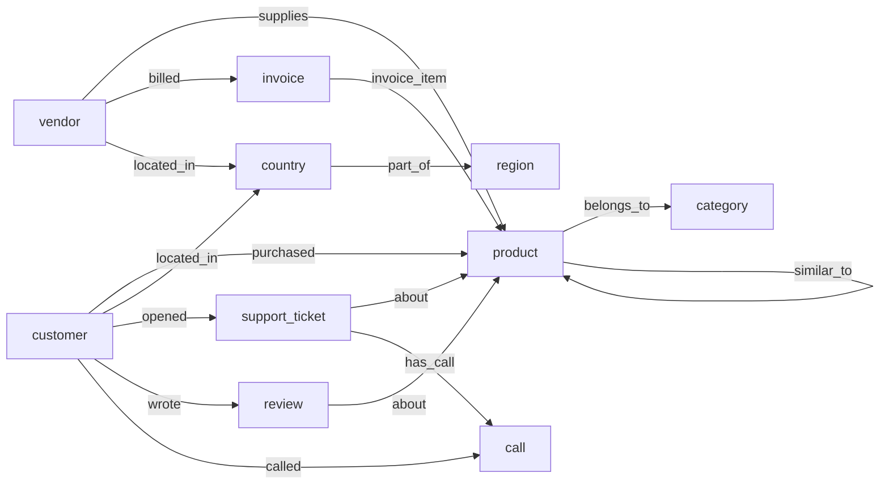

# Graph Model

The `graph` stage loads Silver `clean` entities, enriched with their Gold features, into
SurrealDB as a knowledge graph for analytics and GraphRAG.

| Piece | Location |
|---|---|
| Schema (SurrealQL) | `src/graph/schema.surql` |
| Node/edge mapping (pure Python, unit-tested) | `src/graph/model.py` |
| Loader: schema, batched upserts, pruning, count check | `src/graph/loader.py` |
| The 8 queries with explanations | `src/graph/queries.py` |
| Query results from the last run | `outputs/graph_queries.md` |



**10 node tables, 13 edge tables; 2,390 nodes and 11,833 edges** on the assessment data.

## Modelling decisions

| Decision | Why |
|---|---|
| **Record ids are business keys** (`product:⟨PRD-000001⟩`, `purchased:⟨TXN-…⟩`, `invoice_item:⟨INV-…_3⟩`) | Every write is `INSERT … ON DUPLICATE KEY UPDATE`, so reloading the same data changes nothing and no lookup table is needed. |
| **One `purchased` edge per transaction**, not one per customer–product pair | Keeps date, quantity, amounts and statuses on the edge, so history, recency and returns stay queryable. A per-pair edge would have to pre-aggregate and lose them. |
| **`recognised` flag on `purchased`** | The same revenue rule as the Gold features (captured payment, order not cancelled), so graph queries and feature tables agree. Failed and refunded transactions stay in the graph as behaviour. |
| **Gold features stored as node properties** | Queries filter on `days_overdue` or `rfm_segment` directly; the formulas live once, in the features stage, not again in SurrealQL. |
| **Country and region as nodes** | Region was a string on vendors only. As nodes, "customers in Europe" is a traversal (`region<-part_of<-country<-located_in<-customer`), and the mapping comes from config, not repeated strings. The transaction's own `region` is a *sales* region (it includes Latin America and the Middle East, where no customer lives), so it stays a property, `sales_region`, on the edge. |
| **`similar_to` from co-purchase**, weighted by `shared_customers`, stored in both directions | Precomputing the edge keeps "bought together" a one-hop lookup; computing it per query is a self-join over every purchase. 1,098 edges. |
| **Tickets, reviews and calls as text nodes** linked to the customer and product they concern | GraphRAG retrieves text by walking from an entity to its context. Call utterances are joined into one `speaker: text` transcript per call, ready for embedding. |
| **Orphan references create no edge** | 194 purchases, 16 invoices and 537 invoice lines point at records that do not exist. The rows are kept in Silver (flagged); an edge to nothing would be invalid (`TYPE RELATION FROM … TO …` enforces both ends). Skips are counted and logged per edge type, and listed at the top of `outputs/graph_queries.md`. As a result, graph-traversal sales are lower than Gold `revenue_generated` by the sales to unknown customers. |
| **No email, phone or street address in the graph** | Data minimisation: analytics and GraphRAG need behaviour, not contact details. Silver keeps them. |
| **`SCHEMAFULL` with typed fields and `option<…>` for nullable ones** | A bad type fails the load instead of drifting silently. `DEFINE … OVERWRITE` re-applies the schema on every load, so changes need no migration step. |

## Loading

1. Apply `schema.surql`.
2. Upsert nodes, then edges, in batches (`surrealdb.batch_size`, 500).
3. Delete records whose `batch_id` is not this run's (deleted upstream). Edges go first, and pruning only happens after every write has succeeded, so a failed load never removes data.
4. Compare the count per table with what was built; a mismatch fails the stage.

**Where it loads.** The default is the SurrealDB server from `docker-compose.yml` (`ws://localhost:8000/rpc`, image pinned to `v4.0.0`, data on the `surrealdb_data` volume):

```bash
docker compose up -d surrealdb
```
```bash
python run_pipeline.py --stages graph
```

If the server is not running the stage fails with a message saying how to start it; it does not silently fall back to another database. Without Docker, `SURREAL_URL=surrealkv://outputs/graph/ecommerce.db` uses the engine embedded in the Python client, persisted to a local file. Credentials come from `SURREAL_USER` / `SURREAL_PASS` (default `root`/`root` locally).

To query the loaded graph by hand:

```bash
docker exec -it coding-test-surrealdb /surreal sql --endpoint http://localhost:8000 --user root --pass root --ns test --db ecommerce
```

**Two engines, one result.** The embedded engine in the `surrealdb` 2.0 Python client is SurrealDB **2.x** (`surrealdb-core` 2.3.10), while the Docker server is **4.0**, and they differ in ways that matter:

| Difference | Handling |
|---|---|
| The client sends `datetime` as CBOR tag 0 (ISO text); the 4.0 server rejects it | `loader.wire()` sends tag 12 (`[seconds, nanoseconds]`), which both accept |
| Function names changed (`type::is::datetime` → `type::is_datetime`; `type::thing` → `type::record`) | Queries use only `array::` and `math::` functions common to both, and record ids are passed as `RecordID` values |
| Ties in `ORDER BY` broke differently, so one "bought together" list differed | Every `ORDER BY` that can tie has a tie-breaker |

The integration tests run against both: always the embedded engine (`mem://`), and the Docker server when it is up (otherwise skipped). The query report is identical on both apart from its header line.

**Compose fixes.** The provided `docker-compose.yml` did not start: SurrealDB 4 rejects the `file:` storage scheme (now `surrealkv:`), and the healthcheck called `curl`, which the distroless image does not contain (now `/surreal is-ready`).

## Query notes

- **Revenue in queries** always uses `purchased[WHERE recognised = true]`.
- **Q4 groups by customer id, not name.** Grouping by name merged two different customers called Robert Dubois into one "top customer".
- **Q4 wraps its grouping in a subquery.** Ordering by the aggregate in the same statement returned rows in name order.
- **Q8's correlation is computed by the report** from the per-vendor rows, because SurrealQL has no correlation function. r = −0.32 across 10 vendors, but it is set by one vendor: Discontinued Supplies has 3 invoices due and $641 of sales, and without it r = +0.82. The report recomputes r leaving out each vendor in turn (`correlation_summary`) and says so; no relationship can be claimed from this data.
