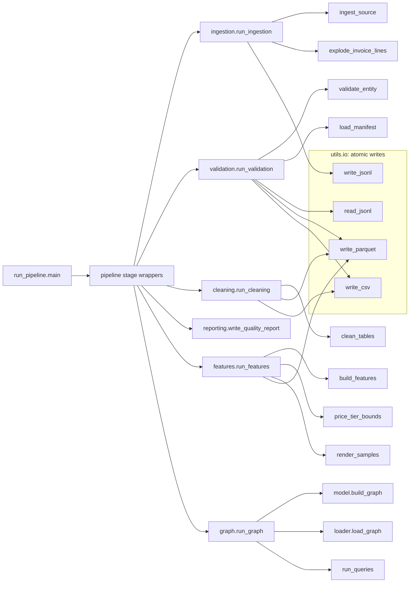

# Code Map and Impact Analysis (Daygent)

I used [Daygent](https://github.com/emyrael/daygent) (`pip install daygent`), an open-source static
lineage and impact-analysis tool I built, to check the structure of this pipeline and the blast
radius of changes. Daygent reads source files only: it runs no code and connects to nothing.

## Reproduce

```bash
pip install "daygent>=0.4"
daygent scan . --full          # settings in daygent.yml (tests and scripts excluded)
daygent graph --html --open    # interactive viewer, written to .daygent/ (gitignored)
daygent impact python_function:utils.io.write_parquet
daygent gaps                   # data references that are only known at runtime
```

`--full` keeps the Python call graph. Without it Daygent keeps only data/AI lineage (tables, files,
models), and here every data path is built from config, as explained [below](#data-access-points).

## What it found

**31 modules, 258 functions and 375 call edges** across `src/` and `run_pipeline.py` (Daygent 0.4.0).

The backbone, drawn from `.daygent/graph.json` (arrows point from caller to callee; Daygent's own
convention is the reverse, "A → B means B depends on A"):



Every stage is reachable from the entry point, and every table write (JSONL, Parquet, CSV) goes
through the atomic helpers in `utils/io.py` (write to a temporary file, then rename), so a crashed
stage never leaves a half-written table. Reports and metrics files are written directly.

## Impact: changing the shared writer

```text
$ daygent impact python_function:utils.io.write_parquet
Impact: write_parquet()

Direct:
  → run_cleaning()
  → run_features()
  → run_validation()

Downstream:
  → _clean()
  → _features()
  → _validate()
```

A change to the Parquet writer touches three stages (validate, clean, features), and so every Silver
and Gold table. That is the scope to test before shipping it; the integration tests cover all three.

## Data access points

`daygent gaps` lists **12 file reads and writes, none resolvable statically**:

| Stage | Location | Kind | Path expression |
|---|---|---|---|
| ingest | `src/ingestion/loaders.py:91` | read | `path` (from the `sources` config) |
| validate | `src/validation/validator.py:177` | write | `out_dir / f'{entity}.parquet'` |
| validate | `src/validation/validator.py:178` | write | `config.paths.quarantine_dir / f'{entity}.csv'` |
| clean | `src/cleaning/clean.py:266` | read | `validated_dir / f'{name}.parquet'` |
| clean | `src/cleaning/clean.py:271` | write | `out_dir / f'{name}.parquet'` |
| clean | `src/cleaning/clean.py:277` | write | `config.paths.quarantine_dir / DUPLICATES_FILE` |
| features | `src/features/build.py:265` | read | `clean_dir / f'{name}.parquet'` |
| features | `src/features/build.py:268` | write | `config.paths.gold_dir / f'{name}.parquet'` |
| graph | `src/graph/stage.py:28` | read | `config.paths.silver_dir / CLEAN_SUBDIR / f'{n}.parquet'` |
| graph | `src/graph/stage.py:29` | read | `config.paths.gold_dir / f'{n}.parquet'` |
| (helpers) | `src/utils/io.py:59`, `:66` | write | `tmp` (the atomic-write temporary file) |

This is by design: the brief asks for no hardcoded paths, so every location comes from
`config/pipeline_config.yaml`. A static tool cannot know those values, and Daygent reports them as
gaps instead of guessing. The data flow itself (raw → Bronze → Silver → Gold → SurrealDB) is
documented in [ARCHITECTURE.md](../ARCHITECTURE.md#1-overview).

## What running it here changed in Daygent

Running Daygent on this repository exposed gaps that I fixed in Daygent 0.4.0:

| Found on this repo (0.3.0) | Fixed in 0.4.0 |
|---|---|
| Imports written as `from src.cleaning.clean import …` did not resolve, so no call crossed a file (114 edges) | `src.`-prefixed imports resolve: 375 edges, the whole stage chain is connected |
| pandas file I/O (`read_parquet`, `to_parquet`, …) was invisible | file reads and writes are lineage when the path is literal, and listed as gaps otherwise |
| `.daygent/` showed up as untracked | the scan output ignores itself |

Still out of reach statically, and noted as Daygent's next steps:
- config-driven paths (declaring path roots in `daygent.yml`);
- stages called through the `STAGES` dictionary (dynamic dispatch);
- Pydantic validators, which Pydantic calls at runtime, so the impact of a parser such as `parse_date` stops at the schema.
